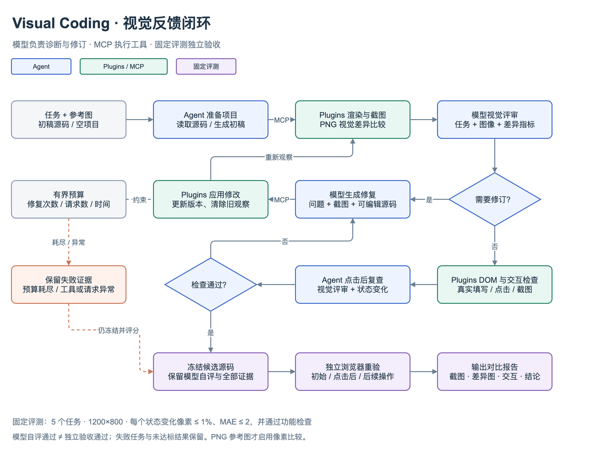

# 视觉反馈流程



流程图由 draw.io 绘制并导出；[源文件](visual-feedback.drawio) 中的节点与连线均可编辑，[SVG](visual-feedback.svg) 用于矢量显示。

1. **准备项目**：Agent 读取任务、可选参考图与候选源码；空项目由模型生成初稿。实际文件操作通过 MCP 完成。
2. **获取视觉证据**：Plugins 渲染页面并截图；若有 PNG 参考图，调用 `visual_compare` 返回像素指标与差异图。
3. **视觉评审**：模型接收任务、截图和数值差异，视觉诊断不附源码或 DOM。需要修订时，修复请求再加入源码和问题清单。
4. **修改并重验**：Plugins 按预期版本修改代码，丢弃旧版本观察，重新截图与评审。修复次数、模型请求和总耗时均有上限。
5. **验证交互**：检查 DOM、实际填写/点击、确认状态变化，并评审点击后截图。检查不通过可进入修复；预算耗尽或工具异常保留失败证据。
6. **独立评测**：固定评测另行冻结候选源码，在新浏览器中重验初始/点击后两种状态及后续交互；将参考、初稿和最终结果写入报告。

蓝色节点属于 Agent，绿色属于 Plugins，紫色属于固定评测。图中的修复预算节点是所有修订路径的共同约束；工具或请求失败也会终止运行并保留证据。

Agent 的 `finish` 表示模型自评和当前任务检查通过。固定评测只有各状态视觉阈值与独立功能检查均满足时才判通过。两种判断不等价，当前仪表盘任务保留了“模型自评通过、独立像素阈值未通过”的结果。

## 编辑与导出

在 draw.io 桌面版打开 `visual-feedback.drawio` 后编辑。也可用其 CLI 更新预览，例如 macOS：

```sh
/Applications/draw.io.app/Contents/MacOS/draw.io --export --format png --theme light --border 24 --output docs/visual-feedback.png docs/visual-feedback.drawio
/Applications/draw.io.app/Contents/MacOS/draw.io --export --format svg --theme light --border 24 --output docs/visual-feedback.svg docs/visual-feedback.drawio
```

流程图是项目文档；安装 draw.io 不是运行 Agent 或 Plugins 的前提。
